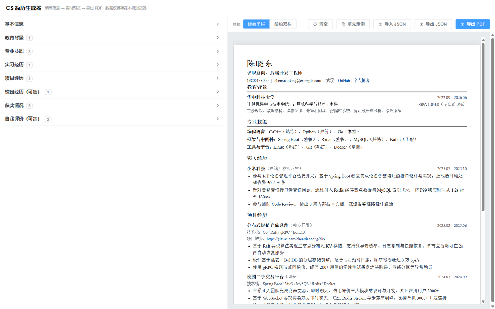
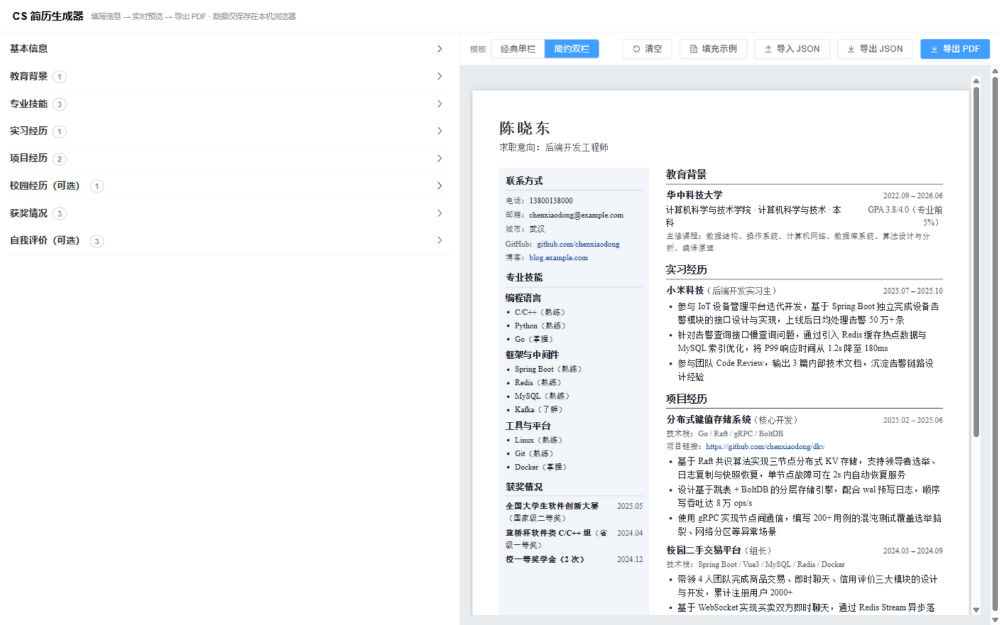
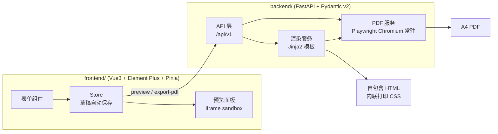

# CS 简历生成器

**填表 → 实时预览 → 一键导出 PDF** 的计算机专业简历生成器。数据与模板完全分离：左侧填写结构化信息，右侧实时预览 A4 排版效果，一键导出打印级 PDF。所有数据仅保存在本机浏览器，不上传任何服务器。

[](https://github.com/whlle-yi/cs-resume-generator/actions/workflows/ci.yml)


## 特性

- 🖥 **表单驱动**：基本信息 / 教育背景 / 专业技能 / 实习经历 / 项目经历 / 校园经历 / 获奖情况 / 自我评价，八大模块按计算机专业求职规范组织
- ⚡ **实时预览**：内容改动 500ms 防抖后自动刷新预览，所见即所得
- 📄 **两套模板**：经典单栏（信息密度高）、简约双栏（信息侧栏 + 主栏），均为打印级 A4 排版
- 🇨🇳 **中文排版**：中文宋体 + 西文/数字 Times New Roman，支持证件照、分页保护（条目不跨页断裂）
- 🔒 **隐私优先**：数据自动保存在本机浏览器 localStorage，可导出 / 导入 JSON 迁移，服务端不留存
- 🧪 **质量保障**：Pydantic v2 全量数据校验（手机号 / 邮箱 / URL / 时间区间）、29 个 pytest 用例、GitHub Actions CI

## 界面预览

**经典单栏**



**简约双栏**



## 架构



- **数据契约唯一**：`backend/app/schemas/resume.py` 的 Pydantic 模型是唯一数据源，前端 `frontend/src/types/resume.ts` 与之镜像
- **模板即模板**：简历版式全部在 `backend/app/templates/`（Jinja2 + 打印 CSS），新增模板零代码改动
- **分层清晰**：api（接口）→ services（业务）→ schemas（契约），详见 [docs/architecture.md](docs/architecture.md)

## 快速开始

### 环境要求

- Python ≥ 3.11
- Node.js ≥ 18（仅开发模式需要；生产模式用预构建产物则不需要）
- PDF 导出依赖 Playwright Chromium（首次安装自动下载）

### 后端

```bash
cd backend
python -m venv .venv
.venv\Scripts\activate          # Windows；Linux/macOS: source .venv/bin/activate
pip install -e .
playwright install chromium     # 首次运行前安装无头浏览器
uvicorn app.main:app --reload --port 8000
```

### 前端（开发模式）

```bash
cd frontend
npm install
npm run dev        # http://localhost:5173，/api 自动代理到 8000
```

### 生产模式（单进程部署）

```bash
cd frontend && npm ci && npm run build   # 产出 frontend/dist
cd ../backend && uvicorn app.main:app --port 8000
# FastAPI 自动托管 frontend/dist，访问 http://localhost:8000 即为完整应用
```

> 后端配置支持环境变量 / `.env`（前缀 `RESUME_`），见 [backend/.env.example](backend/.env.example)。

## API 一览

| 方法 | 路径 | 说明 |
|---|---|---|
| GET | `/api/v1/health` | 健康检查 |
| GET | `/api/v1/meta/templates` | 可用模板列表 |
| GET | `/api/v1/resume/sample` | 示例简历数据 |
| POST | `/api/v1/resume/preview` | 渲染自包含 HTML（`{data, template}`） |
| POST | `/api/v1/resume/export/pdf` | 导出 A4 PDF 文件流 |

交互式文档：启动后端后访问 <http://localhost:8000/docs>（Swagger UI，由 FastAPI 自动生成）。

## 项目结构

```
cs-resume-generator/
├── backend/                  # FastAPI 服务（自包含 Python 工程）
│   ├── app/
│   │   ├── api/v1/           # 路由与端点
│   │   ├── core/             # 配置 / 日志 / 异常体系
│   │   ├── schemas/          # Pydantic 数据契约（唯一数据源）
│   │   ├── services/         # 渲染服务 / PDF 引擎 / 示例数据
│   │   ├── templates/        # 简历模板（Jinja2 + 打印 CSS）
│   │   └── data/             # 示例简历 JSON
│   └── tests/                # pytest（schema / 渲染 / API / PDF 冒烟）
├── frontend/                 # Vue3 + TypeScript + Element Plus + Pinia
│   └── src/
│       ├── api/              # axios 封装
│       ├── components/forms/ # 按模块拆分的表单组件
│       ├── components/preview/
│       ├── stores/           # Pinia + localStorage 草稿
│       ├── types/            # 与后端契约镜像的 TS 类型
│       └── views/            # 主视图（左表单 / 右预览）
├── docs/                     # 架构文档 / 开发指南
└── .github/workflows/        # CI（后端 lint+test / 前端构建）
```

## 数据与隐私

- 简历数据以 **JSON 导入 / 导出**，根节点带 `schema_version` 以便后续结构演进向前兼容
- 草稿自动保存在浏览器 localStorage（键 `cs-resume-generator/draft-v1`），清空浏览器数据即彻底删除
- 服务端无数据库、无账号体系，不持久化任何用户数据

## 测试

```bash
cd backend
pytest -v            # 29 个用例，含需要 Chromium 的 PDF 冒烟测试
ruff check .         # 静态检查

cd ../frontend
npm run build        # vue-tsc 类型检查 + vite 构建
```

## 路线图

- [ ] AI 润色：将口语化描述改写为 STAR 法则简历用语（预留 LLMService 接口位）
- [ ] DOCX 导出（基于本机 WPS COM，作可选功能）
- [ ] 更多模板：技术栈徽标版 / 中英双语版
- [ ] 简历多页支持（当前双栏模板面向单页场景优化）

## FAQ

**Q: 双栏模板内容超过一页会怎样？**
A: 双栏布局依赖 flex，浏览器对多页 flex 分页支持较弱，建议双栏模板用于单页简历；内容较多时选经典单栏（支持多页，条目自动避免跨页断裂）。

**Q: PDF 里的字体是什么？**
A: 中文宋体（SimSun）、西文/数字 Times New Roman，Windows/macOS 系统自带，PDF 由无头 Chromium 按打印 CSS 渲染，与预览一致。

**Q: 为什么预览里点简历里的链接没反应？**
A: 预览 iframe 加了 `sandbox` 防脚本注入，链接点击被禁用；导出的 PDF 中链接可正常跳转。

## 致谢

设计参考了 [rendercv](https://github.com/rendercv/rendercv)（数据与渲染分离）、[reactive-resume](https://github.com/reactive-resume/reactive-resume)（表单驱动架构）与 [ResumeSample](https://github.com/geekcompany/ResumeSample)（中文程序员简历内容规范）。

## License

[MIT](LICENSE)
